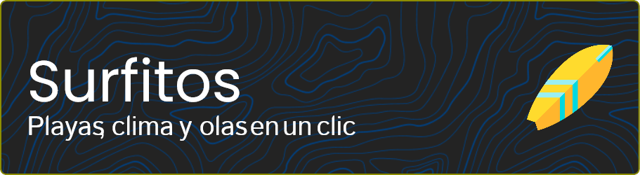
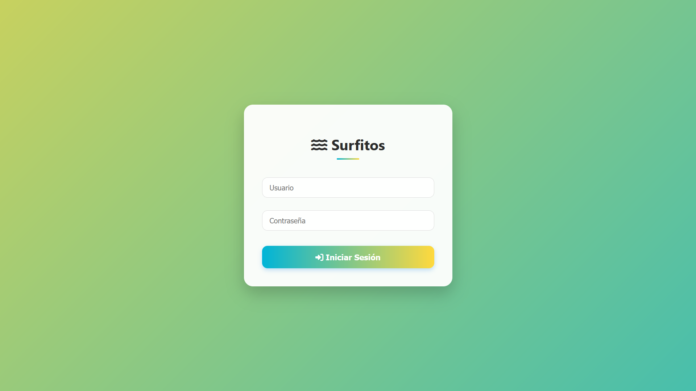
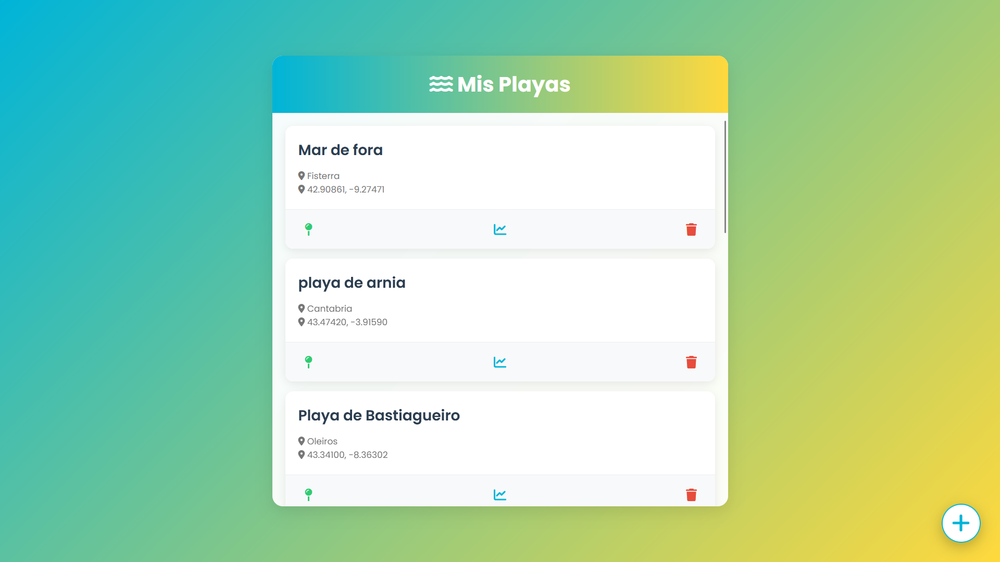
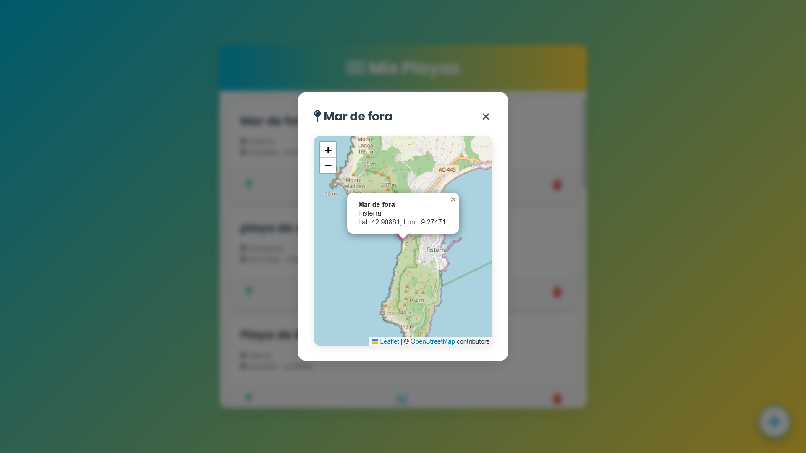
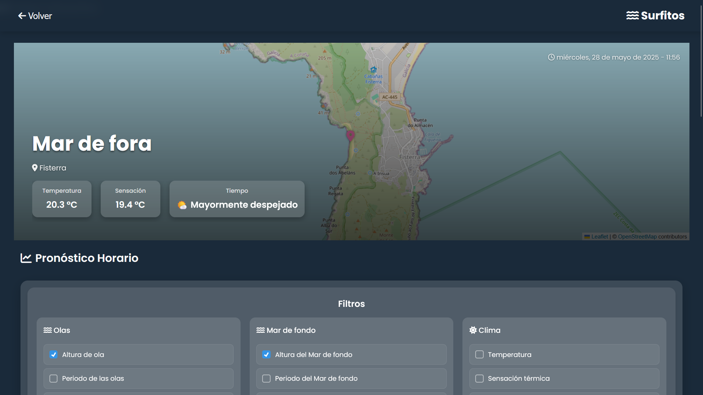
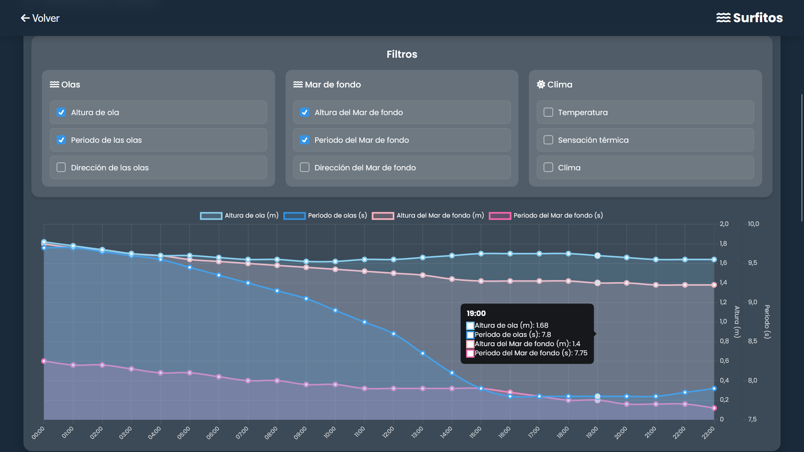
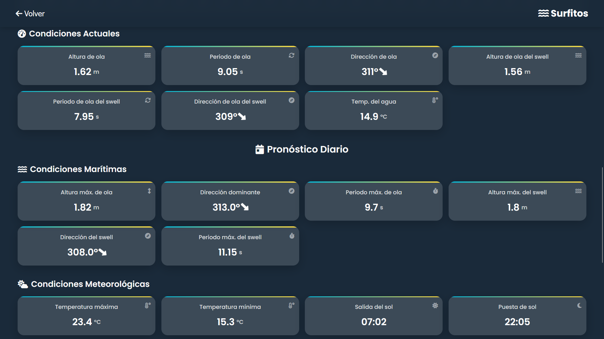
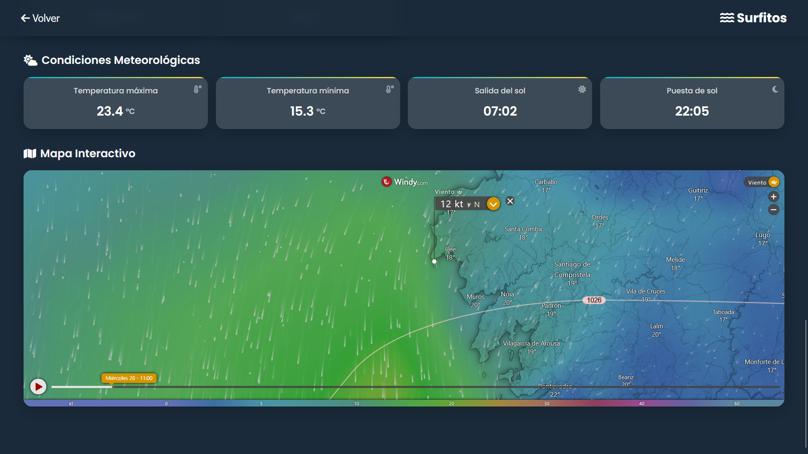

<h1 align="center">
  <br>
  Surfitos <br><br>
  



</h1>

## 📚 Índice

- [🔍 Descripción del proyecto](#descripción-del-proyecto)
- [🚀 Funcionalidades principales](#funcionalidades-principales)
- [🧑‍💻 Tecnologías utilizadas](#tecnologías-utilizadas)
- [🛠️ Instalación y despliegue](#instalación-y-despliegue)
- [🌐 Uso de la API de Open-Meteo](#uso-de-la-api-de-open-meteo)
- [📸 Capturas de pantalla](#capturas-de-pantalla)
- [📦 Requisitos del sistema](#requisitos-del-sistema)

---

## 🔍 Descripción del proyecto

**Surfitos** es una aplicación web desarrollada como Trabajo de Fin de Grado. Su objetivo es permitir a los usuarios consultar en tiempo real las condiciones meteorológicas y del mar en diferentes playas agregadas por lo propios usuarios, con especial utilidad para surfistas y aficionados a deportes acuáticos.

La idea surge en el verano del 2024 cuando mis amigos y yo nos aficionamos al Surf después de probarlo por primera vez ese mismo verano, lo cual nos lleva a comprarnos tablas propias y equipamiento para dejar atrás las escuelas de surf y volvernos surfistas amateur, pero como principiantes que somos, nuestra lectura del tiempo y del mar aún le falta madurar, además, las paginas web hechas para sacar la información que necesitamos tienen publicidad, dan información demás, no concretan lo suficiente o no están hechas para surfistas, si no para marineros.

En ese momento propuse la idea de desarrollar una aplicación para nuestro uso privado centrada en el surf y nació Surfitos.

El proyecto ha sido desarrollado íntegramente por mí y está desplegado actualmente en:

[Surfitos](https://surfitos.mooo.com/)

---

## 🚀 Funcionalidades principales

- Login y autenticación de usuarios
- Selección y gestión de playas
- Visualización de información meteorológica y marítima
- Integración con mapas para localización de playas
- Dashboard con datos actuales y predicciones


---

## 🧑‍💻 Tecnologías utilizadas

- **Frontend:** HTML, CSS, JavaScript
- **Backend:** Django
- **API externa:** [Open-Meteo](https://open-meteo.com/)
- **Base de datos:** SQLite en desarrollo, Postgres en producción
- **Despliegue:** Docker, Nginx
- **Servidor:** Ubuntu 20.04 (equipo local con acceso SSH)

---

## 🛠️ Instalación y despliegue

### 🔧 Requisitos previos

Antes de comenzar, asegúrate de tener instalado:

- [Docker](https://docs.docker.com/get-docker/)
- [Docker Compose](https://docs.docker.com/compose/)
- [Git](https://git-scm.com/)


### 📥 1. Clonar el repositorio

```bash
git clone https://github.com/XDavider/surfitos.git
cd Surfitos
```

### 🐳 2. Construir y levantar los contenedores

```bash
docker-compose up --build
```

### 🌍 3. Acceder a la aplicación

Una vez los contenedores estén corriendo, abre tu navegador en:

http://localhost:8000
<br>
<br>
#### 📌 Producción: uso de Nginx

Este proyecto incluye una configuración de Nginx dentro del contenedor para servir correctamente los archivos estáticos (CSS, JS, imágenes) y enrutar las peticiones al backend de Django.

> [!NOTE]
> 💡 Si planeas desplegar el proyecto en un servidor real (como en surfitos.mooo.com), es recomendable mantener el uso de Nginx u otro servidor proxy inverso similar (como Apache o Caddy) para:
>>- Servir contenido estático de forma eficiente
>> 
>>- Gestionar certificados SSL (HTTPS)
>> 
>>- Reenviar correctamente peticiones al backend (reverse proxy)
>> 
>>- Mejorar la seguridad general de la aplicación
<br>
<br>        
       
### ⚙️ 4. Comandos útiles

  Detener los contenedores:
    
  ```bash
  docker-compose down
  ```

  Reconstruir y reiniciar:
    
  ```bash
  docker-compose up --build
  ```
<br>


### 🐘 5. Migraciones y superusuario (opcional)

Dentro del contenedor, puedes ejecutar comandos Django como migraciones o crear un superusuario:

```bash
docker exec -it surfitos-backend bash
python manage.py migrate
python manage.py createsuperuser
```

---

## 🌐 Uso de la API de Open-Meteo

- **Current weather**: se consulta en tiempo real al cargar el dashboard.
- **Daily forecast**: datos como máximas/mínimas se almacenan cada día.
- **Hourly forecast**: datos por hora usados para gráficos de tendencias.

  
---

## 📸 Capturas de pantalla

- Login
  
  )

- Lista de playas
  
  

- Modo mapa
  
  

- Dashboard
  
  - Header
    
  

  - Gráfica interactiva
    
  

  - Tarjetas de datos
    
  

  - Mapa Interactivo
    
  


---

## 📦 Requisitos del sistema

- **Sistema operativo:** Ubuntu 20.04+ recomendado
- **CPU:** 2 núcleos
- **RAM:** 2 GB mínimo
- **Disco:** 10 GB libres
- **Software:** Docker, Git
